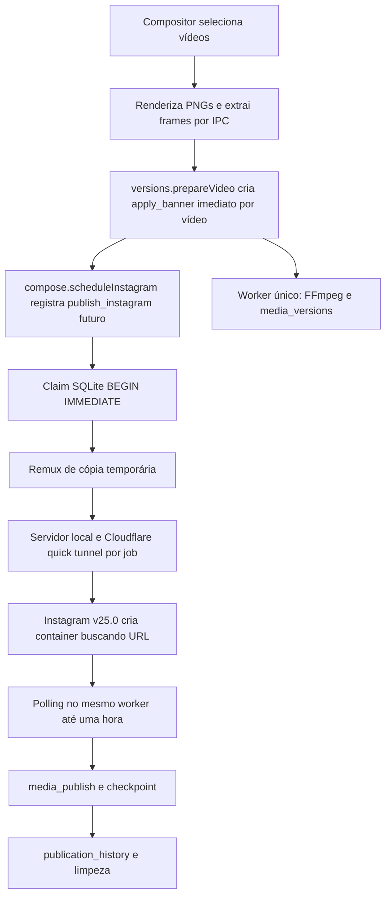

# Pipeline observado — 2026-10-07 (antes das alterações desta auditoria)

Electron/React → IPC validado com Zod → serviços → SQLite WAL (main + utility process). Um supervisor inicia um único utility process; um loop consome um job de cada vez. Não existem Redis, upload direto nem publicação TikTok: TikTok é exportação manual.

## Persistência e fronteiras

`jobs`: payload JSON, queued/running/done/failed/cancelled, run_at, tentativas, lease, idempotency_key UNIQUE e result_json. `job_attempts`: histórico. `media_assets`: originais, hash e validação. `media_versions`: derivados permanentes. `settings`: uma instagramAccount e um secret.instagramToken por workspace, protegido por safeStorage no main e enviado ao worker em memória. `publication_history`: UNIQUE job_id, independente das origens.

Agendamento/consultas SQLite são síncronos; FFmpeg, requests HTTPS, túneis e extração/renderização são assíncronos. Batch é somente batchId no payload; porém edição antecede agendamento e não possui dependência persistida confiável. Versão ainda não pronta falha na publicação. Uma falha no loop do compositor aborta o restante da ação; edições previamente criadas continuam.

Claim transacional com compare-and-swap de state; completion/fail conferem attempts. Heartbeat só confere id e state, portanto worker antigo pode renovar lease nova. Checkpoint remoto não confere proprietário. Recuperação só no startup/ociosidade. Supervisor reinicia com backoff 1–30 s. Shutdown encerra após 5 s; não há cancelamento propagado a FFmpeg. Lease padrão 60 s, heartbeat 20 s. Request Instagram 30 s; FFmpeg 10 min (remux 5 min). Publicação espera até 1 h; erros explícitos são todos permanentes, inclusive HTTP 429/5xx classificados como invalid_input.

Temporários de remux em workspace/tmp/publish; registry em memória mantém URL por 15 min. Restart remove todos os temporários; não recupera URL de tunnel anterior. Derivados em assets/versions; não há TTL/LRU nem cache por conteúdo. Limpeza opcional após publicação pode remover original quando não há outro job referenciando-o.

Índices: jobs(state,run_at), jobs(workspace,type,state), idempotency unique. Ordenação por prioridade usa subconsulta settings; queryJobs e queueContext fazem N+1 por linha. Poll de fila de 1 s; observabilidade existente com AsyncLocalStorage, redaction e heartbeat. Não há limites hierárquicos nem quotas dinâmicas.
