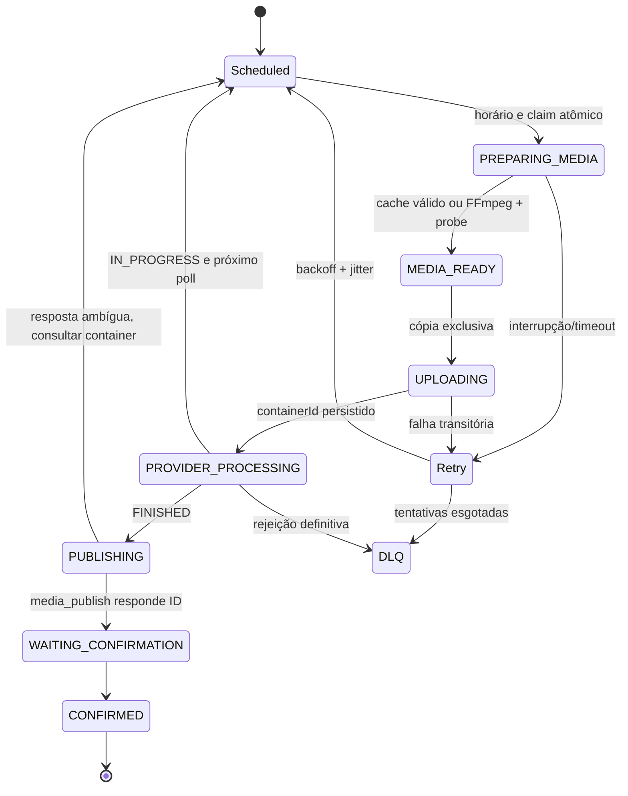

# State machine de publicação

`jobs.state` continua compatível com a interface: queued, running, done, failed, cancelled. `result_json.stage` registra etapas; checkpoints antigos com creating/containerId/publishing/mediaId continuam legíveis.

## Invariantes

- UNIQUE idempotency_key evita dupla intenção para mídia/conta/horário; retornar job existente não cria outra publicação.
- Lease version cresce em todo claim, independente de attempts. Heartbeat de proprietário antigo não renova lease nova. Complete/fail/save também exigem lease válida e versão.
- Media processing ID e upload ID se vinculam ao job; containerId/mediaId são os IDs oficiais disponíveis. Não inventar confirmação sem ID/status oficial.
- Creating é gravado antes do POST /media. Se a resposta se perde sem containerId, a nova tentativa para em erro de confirmação para revisão; nenhum novo POST é feito automaticamente.
- Publishing é gravado antes de /media_publish. Resposta perdida retoma GET no mesmo container. PUBLISHED confirma sem segundo POST. ERROR/EXPIRED durante publish ambíguo preserva o container para revisão.
- HTTP 429 e 5xx podem reagendar; 5xx de um POST ainda é resultado ambíguo. Status GET 5xx não destrói checkpoint.
- IN_PROGRESS libera o slot e mantém exposição até FINISHED/TTL. Polling tem registro de tentativa provider_pending, mas não aumenta attempts de falha.
- Job failed é a DLQ local, acessível por fila/detalhes/retry/reagendamento. Retry não apaga checkpoints. Não há broker separado.
- FFmpeg interrompido/timeout é transitório; mídia inválida, permissão e credencial inválida são definitivos até intervenção. Shutdown encerra ferramentas e deixa recuperação segura pelo checkpoint.
- Original nunca é alterado. Publicação automática limpa somente temporários; cleanupAfterPublish legado não remove original.

## Pontos de atenção restantes

Não prometer exactly-once entre SQLite e uma API sem transação distribuída ou chave idempotente oficial. O sistema prefere reconciliação/manual review à repetição de POST ambíguo. Crash abrupto pode deixar subprocesso: supervisor coleta PIDs de ferramenta e verifica nome/parent antes de encerrar órfãos no Windows; execução normal de shutdown também cancela ferramentas. Corrida entre crash, POST em trânsito e expiração requer certificação com provider/sandbox real.
