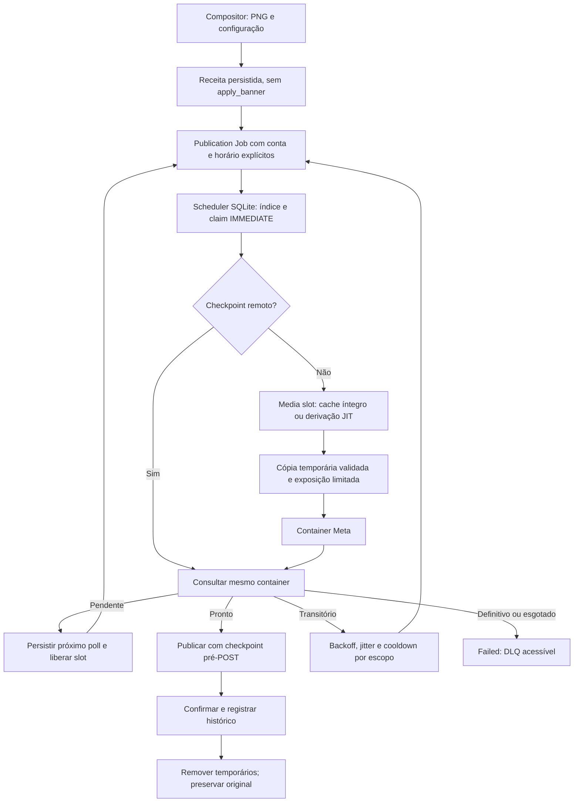

# Arquitetura alvo e decisão

**Status:** implementação local em validação; integração externa e capacidade de produção ainda não certificadas.
**Data:** 2026-10-07.

## Decisão

Manter SQLite WAL e o utility process supervisionado. Trocar trabalho antecipado por receitas persistidas e tentativas curtas da state machine. Dois slots de execução compartilham um semáforo de mídia (padrão 1); no máximo duas exposições de mídia e duas execuções Instagram, com uma por conta. Limites são locais e configuráveis, não quotas da Meta.

Batch é agrupador lógico; não há barrier nem dependência entre publicações. `publications.schedule` aceita intenções Instagram com destinos/horários distintos no mesmo batchId. O compositor atual permite escolher a conta por ação; edição manual independente continua disponível. TikTok mantém exportação manual, e ainda não é um provider de publicação automática.

## Alternativas comparadas

| Opção | Benefício | Custo/risco | Decisão |
|---|---|---|---|
| SQLite + state machine + slots locais | Compatibilidade desktop, sem serviço extra, checkpoints duráveis | Um writer, um host, não distribuído | Adotada |
| Redis + workers distribuídos por etapa | Escala entre hosts e métricas de broker | Redis, instalação, operação, novas fronteiras de credenciais/túneis | Não justificada pelos ensaios atuais |
| Um job esperando todo o ciclo | Simples | Um provider lento ocupa capacidade por uma hora | Retirada do caminho do worker |
| Mais workers sem limiter | Paralelismo bruto | CPU/I/O/túneis e duplicações | Rejeitada |

## Isolamento e segurança

`destination_accounts` tem chave workspace/provider/provider_id, estado e identidade; tokens protegidos em `secret.instagramToken:<providerId>` e snapshots em memória por workspace. Execução usa accountId explícito. A seleção default legada é compatibilidade de interface, não roteamento de credencial. Migração importa a conta antiga antes de cadastrar a nova. Desconectar A não toca B. Reconectar o mesmo provider ID mantém a revisão de destino e permite retomar jobs; trocar o destino não redireciona tarefas existentes.

Lease monotônica (`lease_version`) protege heartbeat, checkpoint, complete e fail mesmo quando tentativas são zeradas por retry manual. O worker verifica posse antes de chamadas externas; ainda não há fencing remoto aceito pelo provider. Uma chamada já em trânsito não pode ser desfeita por um lock local.

## Limites e circuitos

Claim limita execução global Instagram e por conta; provider_limits persiste cooldown por workspace/provider/conta/operação. Erros reconhecidos como app-wide usam escopo de conta vazio, os demais limitam a conta. `Retry-After` em segundos/data é respeitado; jitter, backoff exponencial e circuit cooldown configuráveis. Conservadoramente, cooldown de uma operação pausa todos os jobs novos daquela conta; confirmação retoma depois do prazo. Não há quotas numéricas oficiais hardcoded nem token bucket. Desde o PR 05, `content_publishing_limit` é lido por conta (snapshot em `provider_quota_snapshots`), usado no agendamento atômico e no adiamento da fila; veja [PR 05](pr05-quota-scheduler.md). Headers de uso ficam para validação da versão da API.

## Storage

Original da biblioteca é preservado na publicação automática. Remux e exposição têm cleanup; falhas limpam cópias parciais; startup limpa tmp/publish. Cache inclui hash real do original, hash de capa/banner, janela e versão de processamento. Manifest com hash do output + ffprobe permite reusar apenas saída íntegra. Cache é por workspace e tem TTL de 24 h, varrido no startup (não LRU contínuo). Uma publicação remuxa a saída para arquivo próprio, isolando o cache do lifecycle do host.

Receitas/PNGs permanecem para retry; coleta de PNGs órfãos e limites por bytes de cache ainda precisam de política adicional. O download/cache de perfis permanece fora desta mudança. Crash de tunnel durante leitura pode invalidar o upload; checkpoint impede replay do publish e uma falha explícita de container pode ser revisada/reexecutada com novo container.

## Configuração central

Variáveis em `src/main/pipeline-config.ts`, validadas no startup:

| Variável | Padrão | Significado |
|---|---:|---|
| LEGACY_WORKER_CONCURRENCY | 2 | Slots no utility process |
| MEDIA_CONCURRENCY | 1 | FFmpeg simultâneos, incluindo previews |
| UPLOAD_CONCURRENCY | 2 | Exposições simultâneas |
| PUBLISH_CONCURRENCY | 2 | Jobs Instagram running |
| INSTAGRAM_ACCOUNT_CONCURRENCY | 1 | Jobs running por destino |
| MAX_RETRIES | 24 | Tentativas que falham; polling não consome |
| STALLED_TIMEOUT | 60000 ms | Lease; heartbeat a cada 1/3 |
| JOB_TIMEOUT | 600000 ms | Timeout padrão da ferramenta; requests têm 30 s |
| PROVIDER_POLL_MS | 15000 ms | Próxima consulta persistida |
| CONFIRMATION_TIMEOUT | 3600000 ms | Revisão necessária após publicação ambígua |
| PROCESSED_CACHE_TTL | 86400000 ms | Expiração de cache |
| PROVIDER_CIRCUIT_FAILURES | 5 | Falhas antes do cooldown maior |
| PROVIDER_CIRCUIT_COOLDOWN | 60000 ms | Circuit cooldown local |

Não configurar 8 FFmpeg em produção por causa de um ensaio sintético curto. Padrões são limites de proteção para piloto, não garantia de carga confortável. Refresh OAuth, permissões reais, expiração automática e Direct Post TikTok permanecem trabalhos explícitos; o schema não equivale a um fluxo OAuth implementado.
